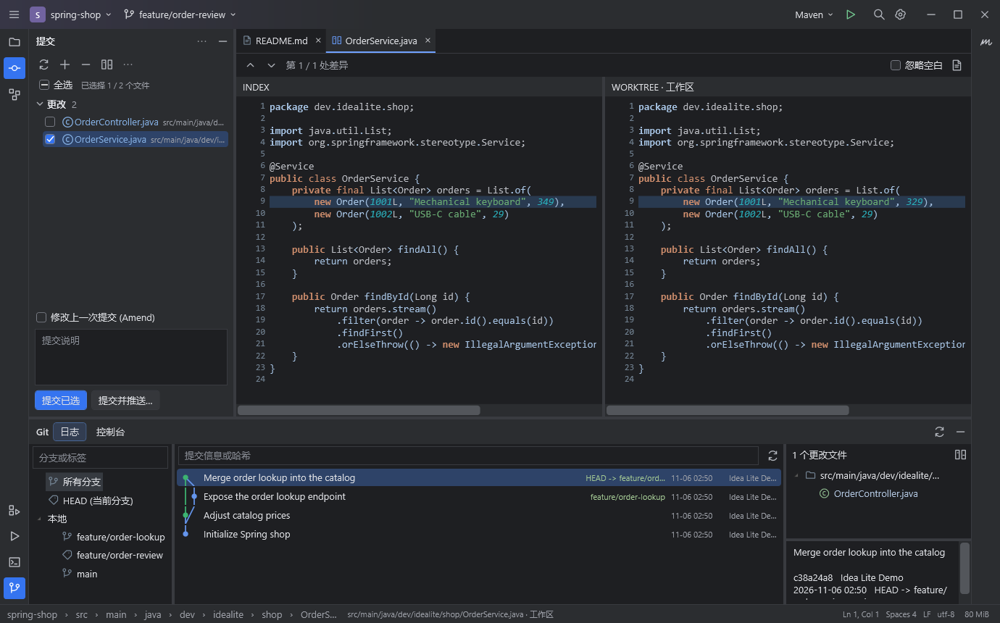

<p align="center"><b>il</b></p>

# Idea Lite

**轻装看代码，专注每一次改动。**

[](https://github.com/keweizhuazuki/idea-lite/actions/workflows/ci.yml)
[](LICENSE)
[](https://github.com/keweizhuazuki/idea-lite/releases/latest)

公司电脑配置一般，AI 又能一下改很多文件。只是想看一眼代码和 diff、处理冲突、提交改动，却要先打开一个完整 IDE、等它索引，还得占着大量内存。

Idea Lite 就是为这个场景做的：一个 Windows 原生的代码编辑器和 Git 工作台。保留常用的 IDEA 操作习惯，把资源留给真正需要的工作。



上图使用合成示例数据，由原生 WPF 控件离屏渲染。

## v0.2.0 的界面调整

默认采用左侧 Commit、底部 Git 日志的布局。顶部是项目与 Git 分支选择器，编辑区使用文件与 Diff 标签，Maven 位于右侧，Spring 信息位于底部服务窗口。深色配色、工具栏、侧边工具按钮和状态栏均按熟悉的 IDEA 布局组织。

- **Ctrl+K / Alt+0** 打开左侧提交窗口，按更改、未版本化文件、冲突分组，每个文件只出现一次并可勾选。双击文件或 **Ctrl+D** 打开 Diff，**F4** 跳转源文件。
- **Alt+9** 打开底部 Git 日志。左边筛选分支，中间显示真实父子关系的分支图，右边显示更改文件与提交详情。双击右侧文件可比较该提交与父版本。
- **Alt+1** 打开项目，**Alt+7** 打开结构，**Alt+8** 打开服务，**Ctrl+Shift+F12** 收起或恢复工具窗口。
- 双击 Shift 的搜索窗口支持全部、类、文件、符号、操作、文本；分支选择器支持搜索与签出，推送前显示目标分支与提交预览。
- 冲突使用独立三栏窗口，左侧本地版本、中间可编辑的合并结果、右侧传入版本。处理完点击“应用并暂存”。
- 工具窗口大小和位置自动记忆。设置菜单可将 Commit 移到底部 Git，再切回左侧。

布局参考 JetBrains 的 [IDEA 界面](https://www.jetbrains.com/help/idea/guided-tour-around-the-user-interface.html)、[提交窗口](https://www.jetbrains.com/help/idea/commit-and-push-changes.html)和 [Git 日志](https://www.jetbrains.com/help/idea/log-tab.html)。图标与界面代码由本项目绘制和实现。

## 下载与开始

到 [Releases](https://github.com/keweizhuazuki/idea-lite/releases/latest) 下载 Windows x64 包，解压后打开 `IdeaLite.exe`。

| 版本 | 适合谁 | 运行要求 |
| --- | --- | --- |
| `IdeaLite-win-x64-framework.zip` | 已安装 .NET 的电脑，下载小于 1 MiB | [.NET 10 Desktop Runtime x64](https://dotnet.microsoft.com/download/dotnet/10.0)，注意选择 Desktop Runtime |
| `IdeaLite-win-x64-portable.zip` | 想解压即用的电脑，下载约 73 MiB | 自带 .NET 运行时，无需安装 SDK 或 Java |

两种版本的编辑和 Git 功能完全相同。Git 操作需要另行安装 [Git for Windows](https://git-scm.com/downloads/win)，并确保 `git --version` 可用。看 Java 代码、识别 Maven/Spring 不需要启动 JVM；运行 Maven 任务才需要自己的 JDK 和 Maven/项目 Wrapper。

推荐把解压目录、项目、构建缓存放在 D 盘，例如 `D:\Apps\IdeaLite` 和 `D:\code`。应用不创建全局源码缓存，不安装后台服务，也不要求管理员权限。发布包附带 `SHA256SUMS.txt`，可用 `Get-FileHash` 校验。

1. 按 **Ctrl+O** 选择本地项目目录。选择 Git 子目录时会定位到仓库根目录。
2. 按 **Ctrl+K** 打开左侧 Commit，双击改动文件查看双栏 Diff。
3. 双击 **Shift**，搜索文件、Java/Kotlin 类型、方法和 Java 字段；**Ctrl+Shift+F** 搜索项目内容。
4. 编辑、暂存、填写提交说明，勾选本次提交的文件，在提交窗口按 **Ctrl+Enter** 提交。**Ctrl+Shift+K** 打开推送预览。

也可以从命令行直接打开项目：

```powershell
& 'D:\Apps\IdeaLite\IdeaLite.exe' 'D:\code\your-project'
```

## 已经能做什么

| 场景 | v0.2.0 的实现 |
| --- | --- |
| 看代码与编辑 | 语法高亮、行号、多文档标签、撤销重做、自动缩进、文件内查找替换、跳转到行、复制行、行注释、字体缩放 |
| 项目文件树 | 延迟创建目录节点、合并连续单层目录、层级包路径、新建文件、复制路径、在资源管理器显示 |
| AI 改动审查 | 按更改 / 未版本化文件分组打开、双栏逐行对齐、增删行着色、同步滚动、忽略空白、上一处 / 下一处差异 |
| Git 提交树 | 底部 Git 窗口、真实父子关系分支图、分支与文本筛选、最近 150 条记录、文件列表与历史 Diff |
| Git 常用操作 | 暂存 / 取消暂存、提交、切换 / 创建分支、fetch、仅快进 pull、push、stash 保存 / 列表 / 恢复 / pop |
| Git 其他操作 | merge、rebase、cherry-pick、revert、远程仓库、标签、blame、reflog 等可通过完整 Git 参数入口执行；交互式命令可打开项目终端 |
| 冲突处理 | 当前 / 传入版本对照、逐块选择当前 / 传入 / 两者、手工编辑结果、三栏合并、普通与 diff3 冲突、应用并暂存；仍有冲突标记时拒绝“保存并暂存” |
| Maven | 自动发现 `pom.xml`、多模块列表、坐标、属性替换、同一 POM 的 dependencyManagement、直接依赖及 scope；手动运行 Maven 任务 |
| Spring | Boot 入口、Bean / 组件 / 配置类、HTTP 接口路径、application / bootstrap 配置文件；常见 Cloud/Feign、Data/Repository、Security、Cache、Transaction、Async/Scheduling、Kafka/Rabbit/JMS 注解索引 |
| 项目内导航 | Ctrl+鼠标 / Ctrl+B / F12 查找源码定义；按 import、同包、当前文件排序，多个候选让你选择；Alt+Left 返回 |
| 匹配项目风格 | 读取 `.editorconfig`；缺省检测 Tab/空格、缩进宽度和换行；保留编码/BOM；保存时匹配换行、行尾空白和末尾换行策略 |
| 外部修改保护 | 切回窗口时同步当前未编辑文件；未保存的编辑会保留；保存前检查磁盘修改，覆盖前确认；F5 更新文件列表与源码索引 |

源码和 Git 凭据保留在本机；应用没有遥测、云端 AI 调用或自动上传代码的功能。用户主动执行 fetch、pull、push 或 Maven 任务时，相关工具会按项目配置访问网络。

## 关于“轻量”

使用 **WPF + AvalonEdit + 系统 Git**。默认没有浏览器内核、Node 服务、JVM、Java Language Server 或全量依赖下载。普通代码浏览与 Git 审查不需要 Java 环境。

界面右下角显示当前进程的工作集。以下为 v0.1.0 的开发测量记录，v0.2.0 请以本机显示为准。开发机上，打开随仓库提供的 8 文件 Spring 示例，初次观察约 **134 MB**；经过搜索、双栏 Diff、历史、Spring 视图及 UI 自动化检查后，观察到约 **180–210 MB**。这是 Windows 本机的观察值，包含 .NET/WPF，不代表所有机器的保证；Git/Maven 子进程不包含在该数字中，也没有与同一项目的 IDEA 做对照基准。

便携版另一次测试使用 **2,000 个合成 Java 文件、10,000 个符号**：完成索引后观察到约 **193 MiB 工作集、161 MiB 专用内存**，窗口首次出现约 **0.69 秒**。窗口出现时间不代表索引全部完成；合成项目不能代表真实大仓库。测量使用 `Get-Process`，未主动清理工作集或强制 GC。

为避免一次审查拖垮电脑，默认保留明确的上限：

| 项目 | 上限 / 行为 |
| --- | --- |
| 文件列表 | 50,000 个；Git 仓库通过 `git ls-files` 尊重 `.gitignore` |
| 源码索引 | 累计读取约 64 MiB / 80,000 个符号；索引单文件不超过 512 KiB；达到上限会提示 |
| Maven POM | 最多 500 个；单个不超过 1 MiB；不读取外部 XML 实体 |
| 打开的文档 | 12 个；优先关闭未修改的旧文档，保留未保存编辑 |
| 文本编辑 | 单文件 4 MiB；二进制文件不进入文本编辑器 |
| 双栏 Diff | 两侧总计 100 万字符 / 4 万行，超过限制提示使用外部 Git 工具 |
| 项目内容搜索 | 单文件 512 KiB，最多 250 条；支持取消和有超时的正则 |
| 命令输出 | 每个 stdout / stderr 最多 8 MiB，持续排空管道，超过上限明确报错 |
| 大目录 | 默认忽略 `.git`、`.idea`、`node_modules`、`target`、`build`、`bin`、`obj`、`dist` 等 |

非 Git 目录会使用内置目录排除规则，不解释 `.gitignore`。已跟踪但位于上述构建目录中的文件也不会进入源码列表。索引只保留文件名和符号，内容搜索时再读文件；不会把整个项目文本常驻在内存里。

可生成隔离的合成项目自行测量：

```powershell
.\scripts\New-BenchmarkWorkspace.ps1 -Files 2000
# 在 Idea Lite 中打开 D:\Codex\work\idea-lite-benchmark
Get-Process IdeaLite | Select-Object Id, WorkingSet64, PrivateMemorySize64
```

## 常用快捷键

| 快捷键 | 操作 |
| --- | --- |
| Ctrl+O | 打开项目 |
| 双击 Shift / Ctrl+P | 全局搜索文件和符号，支持文件名模糊匹配 |
| Ctrl+N / Ctrl+Alt+Shift+N | 搜索类型 / 搜索方法与字段 |
| Ctrl+Shift+N | 搜索文件 |
| Ctrl+Shift+F | 项目内容搜索，可选正则和区分大小写 |
| Ctrl+F / F3 / Shift+F3 | 当前文件查找 / 下一个 / 上一个 |
| Ctrl+H | 当前文件按字面文本批量替换，区分大小写，可撤销 |
| Ctrl+鼠标 / Ctrl+B / F12 | 项目内定义跳转 |
| Ctrl+Alt+Left / Alt+Left | 返回上次跳转位置 |
| Ctrl+G | 跳转到行号或 `行:列` |
| Ctrl+S | 保存并匹配项目空白风格 |
| Ctrl+Alt+L | 统一缩进中的 Tab / 空格，可撤销 |
| Ctrl+D / Ctrl+/ | 编辑器中复制当前行 / 切换行注释 |
| Ctrl+W / Ctrl+Tab / Ctrl+Shift+Tab | 关闭 / 下一个 / 上一个文档 |
| Ctrl+K / Alt+0 | 打开左侧提交窗口并聚焦提交说明 / 改动列表 |
| Ctrl+Enter / Ctrl+Shift+K | 在提交窗口提交勾选文件 / 推送预览 |
| Alt+1 / Alt+9 / Alt+8 | 项目 / Git 日志 / 服务 |
| Alt+7 / Alt+4 / Alt+F12 | 结构 / 运行输出 / 在系统终端打开项目 |
| Ctrl+D / F4 | 改动列表显示 Diff / 打开源文件 |
| F7 / Shift+F7 | 下一个 / 上一个差异 |
| Ctrl+Shift+F12 | 收起 / 恢复两侧面板，给代码或 Diff 更多空间 |
| Ctrl+滚轮 / F5 | 缩放编辑器字体 / 刷新项目索引和 Git |

## Git 与冲突工作流

左侧 Commit 的“更改”包含 Git 已管理文件的修改、删除和新增，“未版本化文件”包含尚未加入 Git 的文件。勾选框决定本次提交范围，初始不勾选，也可以全选。提交使用勾选文件的工作区内容；未勾选的文件不会混入提交，其他已暂存文件仍保留在暂存区。合并提交需要包含全部合并更改。

暂存操作保留在工具栏。双击文件显示工作区差异；只存在暂存修改时显示暂存差异；右键“查看已暂存差异”可单独检查 HEAD 与 index。Amend 会确认后改写上一次提交；推送窗口会展示目标引用。

底部 Git 日志支持分支筛选、提交信息/作者/哈希搜索。合并提交的文件列表和历史 Diff 默认与第一个父提交比较，初始提交与空版本比较。日志的文本筛选会隐藏连接线，避免将隐藏的中间提交画成直接父子关系。历史文件列表显示最多 1,500 个条目；分支树显示筛选后的前 1,000 项，分支弹窗显示前 500 项。

遇到文本冲突时，双击冲突文件进入三栏合并窗口。两侧对应 Git stage 2 / stage 3，中间保留当前工作文件和冲突标记，也支持已经手动处理过一部分的文件。每次“采用左侧”“采用右侧”或“保留两者”替换当前冲突块，中间可直接编辑并撤销。处理完点击“应用并暂存”，再通过 Git 菜单继续 merge 或 rebase。rebase 中 ours/theirs 遵循 Git 索引语义。

**Git → 完整 Git 命令** 接受 `git` 后面的参数，参数直接传给进程，不经过 shell。例如：

```text
push -u origin main
remote add origin https://github.com/you/project.git
tag v0.1.0
blame -- src/main/java/demo/Service.java
rebase --continue
merge --abort
```

reset、clean、强推等可能丢弃数据或改写历史的常见命令会再次确认。完整参数入口不是安全沙箱，交互式 rebase、凭据输入、复杂 submodule/worktree 操作建议在 **Git → 在终端中打开项目** 中执行。应用使用已有 Git 配置，不存储密码。网络认证需先在终端完成。

## Java、Maven、Spring 的边界

这一版采用有上限的源码索引。**它不提供 IntelliJ IDEA 级别的 Java 语义分析。**

- 支持常见声明、注解和本地源码的查找；复杂泛型、重载、继承、Lombok 生成成员、JAR 中的定义、动态代理和类型推断没有编译器级保证。Kotlin 支持是基础扫描。
- Spring 识别基于源码注解与配置文件名，不启动应用，不构建完整 Bean 依赖图，也不求值 SpEL、条件装配或所有组合注解。复杂/多路径映射需要查看源码确认。
- Maven 显示本地 POM 信息和直接依赖，不解析完整依赖传递图、远程父 POM/BOM、所有 profile 或 effective-pom。依赖由父 POM/BOM 管理时会明确标注。
- `.editorconfig` 支持常见的 `*`、`**`、`?`、`{a,b}` 模式和缩进、换行、字符集、末尾换行、行尾空白设置，不是完整 EditorConfig 规范实现。没有配置时优先保留当前文件的编码和风格，旧中文文件可识别 GBK。
- Ctrl+Alt+L 统一缩进空白，不重新排版 Java 语句。需要项目的完整格式化规则时，可以手动执行已有的 Maven formatter / Spotless 任务。
- 当前发布 Windows x64。没有调试器、运行配置系统、插件市场、语义补全、代码重构、分块暂存或二进制/删除冲突的图形合并器。常用 Git 操作有直接界面，其余由完整 Git 参数入口和项目终端补足。

这些边界用于控制默认资源开销。后续方向是可选、显式启用的语言服务、代码折叠、语义补全、分块暂存；相关能力尚未实现。

## 本地开发

需要 Windows x64、[.NET 10 SDK](https://dotnet.microsoft.com/download/dotnet/10.0) 和 Git。

```powershell
git clone https://github.com/keweizhuazuki/idea-lite.git
cd idea-lite
dotnet restore IdeaLite.slnx --locked-mode
dotnet build IdeaLite.slnx -c Release --no-restore
dotnet run --project tests/IdeaLite.Tests -c Release --no-build
dotnet run --project src/IdeaLite -- 'D:\code\your-project'
```

仓库自带 25 项行为/集成测试，覆盖真实 Git 仓库中的暂存/未暂存、首次提交、中文和带空格路径、重命名删除、合并冲突、stash、本地远程推拉，以及编码、风格、搜索、外部修改保护、进程超时、Maven 命令参数传递和按文件提交范围保护。另有 3 项无桌面交互的 WPF 回归检查，覆盖深色子菜单、复选框绑定和异步滚动同步。测试不访问外部 Git 服务，失败会保留临时现场。

创建一个带提交历史和改动的演示仓库：

```powershell
.\scripts\New-DemoWorkspace.ps1
# 然后打开 D:\Codex\work\idea-lite-demo
```

一条命令构建、测试并打包两个版本：

```powershell
.\scripts\Build.ps1
# artifacts/IdeaLite-win-x64-framework.zip
# artifacts/IdeaLite-win-x64-portable.zip
# artifacts/SHA256SUMS.txt
```

脚本在存在 D 盘时将 SDK 用户目录、NuGet 缓存和可配置的临时目录放入 `D:\Codex`。所有依赖都有锁文件，CI 在 Windows 上构建并运行相同测试。界面布局设置和最近项目保存在 `D:\Codex\IdeaLite\workbench.json`；可用 `IDEALITE_CONFIG_DIR` 指定其他设置目录。

```text
src/IdeaLite.Core/    Git、文件与编码、冲突、源码索引、Maven/Spring
src/IdeaLite/         WPF 界面、AvalonEdit 编辑器、DiffPlex 差异
tests/IdeaLite.Tests/ 本地集成测试执行器
samples/spring-shop/ 可公开的合成 Java 示例
scripts/             构建、打包和演示/性能测试项目生成
```

欢迎通过 [Issues](https://github.com/keweizhuazuki/idea-lite/issues) 提交真实使用场景，参与方式见 [CONTRIBUTING.md](CONTRIBUTING.md)。项目使用 [MIT License](LICENSE)，第三方组件见 [THIRD-PARTY-NOTICES.md](THIRD-PARTY-NOTICES.md)。Idea Lite 是独立开源项目，与 JetBrains、IntelliJ IDEA 或 Spring 官方没有关联。
