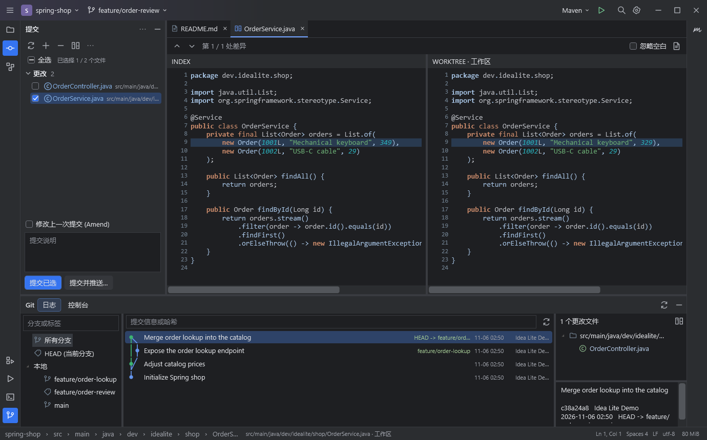
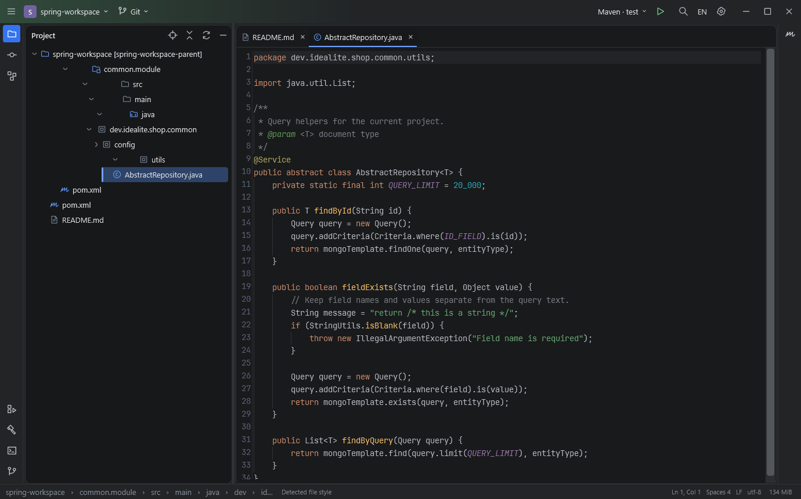

# Idea Lite

**面向 Windows 的轻量代码编辑器和 Git 工作台，采用 IntelliJ IDEA 风格的布局。**

[English](README.md)

[](https://github.com/keweizhuazuki/idea-lite/actions/workflows/ci.yml)
[](LICENSE)
[](https://github.com/keweizhuazuki/idea-lite/releases/latest)

在同一个窗口审查改动、编辑源码、处理冲突和提交。左侧是项目树和提交面板，中间是文件和差异标签，右侧是 Maven，底部是 Git 日志、构建、服务和终端。





两张截图均使用合成示例数据。

## 下载并打开项目

在 [GitHub Releases](https://github.com/keweizhuazuki/idea-lite/releases/latest) 下载 Windows x64 ZIP 包，解压后打开 `IdeaLite.exe`。

| 发布包 | 运行要求 |
| --- | --- |
| `IdeaLite-win-x64-framework.zip` | [.NET 10 Desktop Runtime x64](https://dotnet.microsoft.com/download/dotnet/10.0) |
| `IdeaLite-win-x64-portable.zip` | 自带 .NET 运行时 |

两个包的功能相同。发布页提供 `SHA256SUMS.txt` 用于校验。Git 操作和内置 Git Bash 需要安装 [Git for Windows](https://git-scm.com/downloads/win)。执行 Maven 任务时，配置 JDK 和 Maven，或使用项目的 Maven Wrapper。

1. 按 **Ctrl+O** 选择项目目录。选择 Git 子目录时会打开仓库根目录。打开其他项目或最近项目会启动新进程，保留原窗口和草稿。
2. **连按两次 Shift** 搜索文件、类、符号、操作或文本。点击弹窗外侧或按 **Esc** 即可关闭。
3. 按 **Ctrl+K** 打开提交面板。点击改动文件查看差异，再勾选要提交的文件。
4. 通过 **设置 → 语言** 或右上角 **EN / 中** 切换英语和简体中文。切换时保留打开的文档、草稿和布局。

也可以从命令行传入项目目录。

```powershell
& 'D:\Apps\IdeaLite\IdeaLite.exe' 'D:\code\your-project'
```

## 编辑与导航

- 编辑器内置 JetBrains Mono、Java 语法高亮和缩进线，读取常见 `.editorconfig` 设置，保留文件编码及 BOM，并支持 GBK。项目树区分 Maven 模块、Java 源码根和合并后的包路径。
- 标签超出宽度时，用鼠标滚轮或箭头横向滚动。右侧菜单可切换到任意标签。右键标签可关闭当前、其他或全部标签，批量关闭前会确认是否丢弃草稿。
- **Ctrl+单击** 或 **Ctrl+B** 跳转到已索引的定义。点击 Java 类型声明旁的用法数量可选择引用位置。显式导入的类型还可从直接 Maven 依赖的本地 `-sources.jar` 打开只读源码。
- 编辑器行号旁显示相对 Git HEAD 的新增、修改和删除，包含未保存的编辑。**文件 → 从磁盘重新加载全部文件** 刷新文件列表和索引，保留未保存的草稿。全局搜索可找到新建的未跟踪文件，并遵循 Git 忽略规则。

## Git 审查与分支管理

- **提交**面板区分已暂存、未暂存、未版本化文件和冲突。同一文件可同时出现在已暂存和未暂存分组。暂存差异比较 HEAD 和暂存区，工作区差异比较暂存区和工作文件。
- 双栏差异提供字符级高亮和可点击的总览标记。工作区差异的右栏可编辑，按 **Ctrl+S** 保存。右栏与普通文件标签共享草稿和撤销历史。暂存和历史快照为只读。
- 勾选工作区文件可提交其内容。未勾选工作区文件且暂存区有改动时，**提交暂存区**只提交暂存内容，保留未暂存修改。**修改上一次提交**会填入完整的上一笔提交说明，改写提交前会确认。
- 在分支弹窗点击分支，可按引用类型选择签出、新建、比较、合并、Rebase、工作树、推送、重命名或删除已合并分支。常规签出保留兼容的本地改动，Git 检测到覆盖风险时会停止。**Stash 后切换**保存暂存、未暂存和未跟踪改动，可在 Git 菜单按哈希恢复内容和暂存状态。
- **Git 日志**提供提交图、分支与文本筛选和历史差异。右键提交可 Cherry-pick 到当前分支，Git 菜单提供继续和中止操作。推送失败后，本地提交仍可在原分支的 Git 日志中查看。
- 打开文本冲突可使用三栏合并编辑器，逐块选择本地、传入或两者，也可直接编辑中间结果。完成后点击**应用并暂存**，再通过 Git 菜单继续或中止当前操作。

其他 Git 操作可通过 **Git → 完整 Git 命令**输入 `git` 后面的参数，例如 `reflog` 或 `blame -- src/App.java`。交互式命令和凭据输入可在内置终端完成。

### AI 提交说明

在**提交**面板点击星光按钮生成草稿。在**设置 → AI 提交设置**选择 OpenAI 或 DeepSeek，填写对应的 API Key。两个 Key 分别保存在 Windows 凭据管理器。可选择输出语言、更换模型，以及编辑或预览内置提示词。默认模型为 `gpt-5.4-mini` 和 `deepseek-flash`。

请求生成时，Idea Lite 会把分支名、现有说明和选定差异发送给所选服务商。**提交暂存区**使用暂存差异，**修改上一次提交**会补充原提交上下文。每次最多分析 100 个文件和 16,000 字符的改动上下文，输出上限为 256 tokens。服务商返回用量时会显示在状态栏。请在提交前检查生成的草稿。

提示词支持 `{task_rule}`、`{task_id}`、`{language_rule}` 和 `{language}`。任务号优先从现有说明匹配 AIDF 或 AIGC 编号，再检查分支名。移除 `{task_rule}` 可取消默认的任务号前缀指令。

## Maven 与终端

- 在**设置 → 构建工具与环境**选择 Windows 或 WSL，并浏览选择 Maven 可执行文件、`settings.xml`、本地仓库和 `JAVA_HOME`。WSL 模式会填写 Linux 路径。默认目标和参数可按项目配置。
- 在 Maven 工具窗口运行生命周期任务。构建窗口分批显示日志，并按模块和错误组织，可从 Java 编译错误跳转到源码行。工具栏可重跑或停止任务。
- 按 **Alt+F12** 在项目目录打开 Git Bash，点击 **+** 新建会话。每个标签保留自己的工作目录和命令历史。内置终端使用 Windows ConPTY，支持 ANSI 颜色、Unicode、剪贴板快捷键和 Ctrl+C。

## 常用快捷键

| 快捷键 | 操作 |
| --- | --- |
| Ctrl+O | 在新窗口打开项目 |
| 连按两次 Shift / Ctrl+P | 全局搜索 |
| Ctrl+N / Ctrl+Shift+N / Ctrl+Alt+Shift+N | 搜索类型 / 文件 / 符号 |
| Ctrl+Shift+F | 项目内容搜索 |
| Ctrl+F / Ctrl+H / Ctrl+G | 在编辑器内查找 / 替换 / 跳行 |
| Ctrl+B 或 Ctrl+单击 | 跳转定义 |
| Alt+Left | 返回上次跳转位置 |
| Ctrl+S / Ctrl+Alt+Y | 保存 / 从磁盘重新加载 |
| Ctrl+D / Ctrl+/ / Ctrl+Alt+L | 复制行 / 切换行注释 / 统一缩进 |
| Ctrl+W / Ctrl+Tab / Ctrl+Shift+Tab | 关闭标签 / 下一个标签 / 上一个标签 |
| Ctrl+K / Alt+0 | 打开提交面板并聚焦说明 / 改动列表 |
| Ctrl+Enter / Ctrl+Shift+K | 在提交面板提交 / 预览推送 |
| 提交面板中的 Ctrl+D / F4 | 显示差异 / 打开源文件 |
| F7 / Shift+F7 | 下一处 / 上一处差异 |
| Alt+1 / Alt+7 / Alt+8 / Alt+9 | 项目 / 结构 / 服务 / Git 日志 |
| Alt+4 / Alt+F12 | 构建或运行输出 / 终端 |
| Ctrl+F9 / Shift+F10 | 编译 / 重跑当前 Maven 任务 |
| Ctrl+Shift+F12 | 收起或恢复工具窗口 |

## 功能范围与资源上限

Idea Lite 使用 WPF、AvalonEdit 和系统 Git。浏览源码和审查 Git 改动无需 JVM。Java 和基础 Kotlin 导航使用有上限的源码索引，Maven 信息取自本地 POM，Spring 信息来自源码注解和配置文件名。编译器级语义解析、完整 Maven 依赖图和 Spring 运行时装配超出当前范围。

| 项目 | 默认上限 |
| --- | --- |
| 文件列表 | 50,000 个 |
| 源码索引 | 累计读取约 64 MiB、80,000 个符号、单文件 512 KiB |
| Maven POM | 500 个、单文件 1 MiB |
| 打开的文档 | 12 个，达到上限时可自动关闭未修改的文档 |
| 文本编辑 | 单文件 4 MiB |
| 双栏差异 | 两侧合计 100 万字符、4 万行 |
| 项目内容搜索 | 250 条结果、单文件 512 KiB |
| 命令输出捕获 | 每个输出流 8 MiB |

状态栏显示进程工作集。此前用 2,000 个合成 Java 文件和 10,000 个符号测试便携版时，完成索引后约占 193 MiB 工作集、161 MiB 专用内存，窗口首次出现约耗时 0.69 秒。数据来自单台 Windows 开发机，只测量 Idea Lite 进程。可用下列脚本在本机测量。

```powershell
.\scripts\New-BenchmarkWorkspace.ps1 -Files 2000
# 在 Idea Lite 中打开 D:\Codex\work\idea-lite-benchmark
Get-Process IdeaLite | Select-Object Id, WorkingSet64, PrivateMemorySize64
```

## 本地构建与验证

需要 Windows x64、[.NET 10 SDK](https://dotnet.microsoft.com/download/dotnet/10.0) 和 Git。

```powershell
git clone https://github.com/keweizhuazuki/idea-lite.git
cd idea-lite
dotnet restore IdeaLite.slnx --locked-mode
dotnet build IdeaLite.slnx -c Release --no-restore
dotnet run --project tests/IdeaLite.Tests -c Release --no-build
dotnet run --project tests/IdeaLite.UiChecks -c Release --no-build
dotnet run --project src/IdeaLite -- 'D:\code\your-project'
```

核心测试使用本地临时 Git 仓库。WPF 检查会短暂打开测试窗口，并使用本地测试数据验证 Maven 输出和 AI 响应。核心测试可传入 `-- --with-wsl --keep`，额外验证 WSL 进程行为并保留测试现场。

```powershell
.\scripts\New-DemoWorkspace.ps1
# 在 Idea Lite 中打开 D:\Codex\work\idea-lite-demo
.\scripts\Build.ps1
# 在 artifacts/ 生成两个 ZIP 发布包和 SHA256SUMS.txt
```

界面布局和最近项目保存在设置目录的 `workbench.json`。D 盘可用时默认使用 `D:\Codex\IdeaLite`，否则使用 `%LOCALAPPDATA%\IdeaLite`。可通过 `IDEALITE_CONFIG_DIR` 指定其他目录。操作失败时，错误窗口会显示调用堆栈。本地 `last-error.log` 记录异常类型和堆栈。

| 路径 | 内容 |
| --- | --- |
| [src/IdeaLite.Core](src/IdeaLite.Core) | Git、编码、冲突解析、源码索引、Maven 和 Spring |
| [src/IdeaLite](src/IdeaLite) | WPF 工作台、AvalonEdit 编辑器、DiffPlex 和终端 |
| [tests](tests) | 核心集成测试与 WPF 检查 |
| [samples/spring-shop](samples/spring-shop/README.zh-CN.md) | 合成 Java 和 Spring 示例 |
| [scripts](scripts) | 构建、打包、演示和性能测试脚本 |

参阅[贡献指南](CONTRIBUTING.zh-CN.md)、[安全问题报告](SECURITY.zh-CN.md)和[第三方声明](THIRD-PARTY-NOTICES.zh-CN.md)。使用问题可通过 [GitHub Issues](https://github.com/keweizhuazuki/idea-lite/issues) 反馈。

Idea Lite 是采用 [MIT 许可证](LICENSE)的独立项目。工作台布局参考了 [IntelliJ IDEA 界面](https://www.jetbrains.com/help/idea/guided-tour-around-the-user-interface.html)、[提交窗口](https://www.jetbrains.com/help/idea/commit-and-push-changes.html)和 [Git 日志](https://www.jetbrains.com/help/idea/log-tab.html)。
